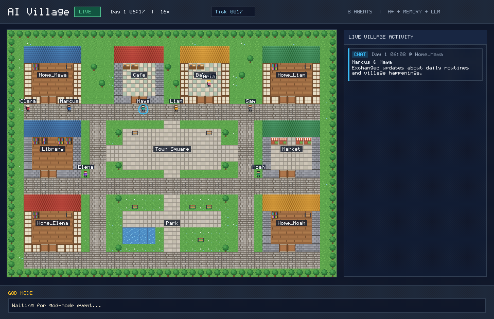
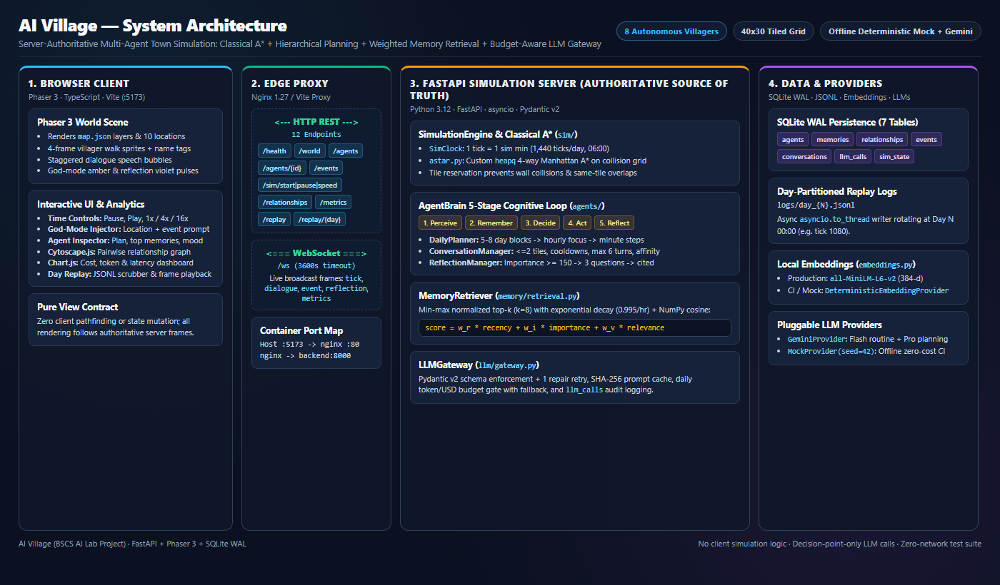

# AI Village — Autonomous Multi-Agent Simulation (Classical AI + LLM Gateway)



[](backend/pyproject.toml)
[](backend/app/main.py)
[](frontend/package.json)
[](backend/app/db.py)
[](docker-compose.yml)

**AI Village** is a 2D browser-based town simulation where **8 autonomous villagers** (*Maya, Liam, Elena, Noah, Clara, Marcus, Aria, Sam*) wake up, generate hierarchical plans, navigate a `40 × 30` Tiled village via custom `heapq` A* search, hold proximity conversations, build weighted episodic memories, reflect on accumulated experiences, evolve pairwise relationships, and react to live **god-mode event injections**.

Inspired by Stanford's *Generative Agents* ("Smallville") and engineered from scratch for a 6th-semester BSCS AI Lab Project and portfolio, AI Village deliberately pairs **classical AI algorithms** with **schema-enforced LLM reasoning** under strict cost and reproducibility controls—running out-of-the-box offline with `MockProvider` (`$0.00`) or live with Google Gemini (`gemini-2.5-flash` + `gemini-2.5-pro`).

> **Portfolio Summary:** Built a multi-agent LLM simulation with memory retrieval, hierarchical planning, A* navigation, and a cost-aware LLM gateway.

---

## Feature Matrix

### Milestone v1.0 — Implemented (P0 + P1)

| ID | Feature | Priority | Implementation Highlights |
| :--- | :--- | :---: | :--- |
| **F1** | Tile-based world & Phaser rendering | **P0** | `40 × 30` Tiled JSON village (`10` named locations), collision grid, Phaser 3 sprite interpolation & speech bubbles (`VillageScene.ts`) |
| **F2** | Custom A* movement | **P0** | Hand-written `heapq` A* (`backend/sim/astar.py`) with admissible Manhattan heuristic, 4-way movement, occupancy avoidance & stall recovery |
| **F3** | Agent personas | **P0** | 8 immutable villager profiles (`Maya`, `Liam`, `Elena`, `Noah`, `Clara`, `Marcus`, `Aria`, `Sam`) with jobs, traits, goals & home anchors |
| **F4** | Episodic memory stream | **P0** | SQLite `memories` table storing `observation`, `plan`, `conversation`, and `reflection` entries with tick timestamps and 384-d `float32` embeddings |
| **F5** | Weighted retrieval scoring | **P0** | Min-max normalized `w_r * recency (0.995^h) + w_i * importance + w_v * cosine_relevance` (`all-MiniLM-L6-v2` or deterministic BLAKE2b fallback, `k=8`) |
| **F6** | Hierarchical daily planning | **P0** | `DailyPlanner`: 5–8 broad daily blocks $\to$ lazy hourly focus & `MinuteStep`s $\to$ prefix-preserving replanning on interruptions |
| **F7** | Proximity conversations | **P0** | Manhattan distance $\le 2$, dual cooldowns (`60` / `30` ticks), up to `6` memory-grounded turns, persisted summaries & canonical affinity updates |
| **F8** | God-mode event injection | **P0** | Live `POST /events` form (free text + optional location) delivering `importance=8` observations to nearby villagers for multi-hop rumor spread |
| **F9** | Threshold-triggered reflection | **P1** | Triggers at `accumulated_importance >= 150`; generates 3 salient questions, retrieves evidence, persists cited insights & updates agent mood |
| **F10** | Relationship tracking & graph | **P1** | Canonical `(agent_a < agent_b)` SQLite affinity store (`[-1.0, 1.0]`) visualized in an interactive **Cytoscape.js** network modal |
| **F11** | Agent Inspector panel | **P1** | Click any villager or chip to inspect persona profile, current action/mood, active hierarchical plan, top memories, cited reflections & relationships |
| **F12** | Simulation time controls | **P1** | Play, pause, and live speed dilation (`1x`, `4x`, `16x`) backed by `POST /sim/start`, `/sim/pause`, `/sim/speed` |
| **F13** | Event log & Day Replay | **P1** | Day-partitioned JSONL logs (`day_1.jsonl`, `day_2.jsonl`, ...) powering `GET /replay/{day}` frame-by-frame scrubber playback |
| **F14** | Cost & token telemetry dashboard | **P1** | Live **Chart.js** dashboard displaying gateway calls by purpose, tokens in/out, cache hit rate, latency & daily budget caps (`GET /metrics`) |

### Stretch Roadmap (P2 — Planned / Not Implemented in v1.0)

| ID | Feature | Priority | Status |
| :--- | :--- | :---: | :--- |
| **F15** | Persona-consistency evaluation (LLM-as-judge) | P2 | Planned (out of v1.0 scope) |
| **F16** | Local Ollama model fallback | P2 | Planned (out of v1.0 scope) |
| **F17** | Day/night lighting cycle & weather events | P2 | Planned (out of v1.0 scope) |

---

## System Architecture



### Classical AI + Schema-Enforced LLM Integration (Why This Is Not a RAG App)

- **Server-Authoritative Loop:** FastAPI (`SimulationEngine`) owns every tick (`1 tick = 1 simulated minute`). The browser client is strictly a renderer and control surface over `/ws` and REST.
- **Not a Static RAG Pipeline:** Vector retrieval (`MemoryRetriever`) is a single internal subroutine inside an embodied cognitive loop (`Perceive -> Remember -> Converse -> Decide -> Reflect -> Act`) where spatial positions, social affinities, moods, and schedules continuously reshape future queries and observations.
- **Zero Tight-Loop LLM Calls:** Every LLM request passes through `backend/llm/gateway.py` strictly at decision points, validated against 9 Pydantic v2 schemas (`extra="forbid"` with 1-retry repair), deduplicated via SHA-256 prompt caching, tiered across `gemini-2.5-flash` (routine) and `gemini-2.5-pro` (planning/reflection), capped by `LLM_DAILY_BUDGET_USD` / `LLM_DAILY_TOKEN_LIMIT`, and logged to `llm_calls`.

---

## Quickstart (<5 Commands)

AI Village runs **100% offline out-of-the-box** using deterministic `MockProvider` (`LLM_PROVIDER=mock`, `EMBEDDING_PROVIDER=auto` $\to$ `mock`).

### Option A: Docker Compose (2 Commands — Recommended)

**PowerShell (Windows):**

```powershell
Copy-Item .env.example .env
docker compose up --build
```

**Bash (Linux / macOS):**

```bash
cp .env.example .env
docker compose up --build
```

Open **`http://localhost:5173`** in your browser (`Nginx` serves the Phaser UI and proxies `/ws` and all REST routes to `backend:8000`).

> **Optional — Run with Live Google Gemini:** Edit `.env` and set `LLM_PROVIDER=gemini` and `GEMINI_API_KEY=your_real_key` (which also enables `local` `all-MiniLM-L6-v2` embeddings automatically), then run `docker compose up --build`. Daily caps default to `LLM_DAILY_BUDGET_USD=0.50` and `LLM_DAILY_TOKEN_LIMIT=250000` with automatic fallback to `MockProvider` if exhausted.

---

### Option B: Local Development (5 Commands Total)

Requires **Python 3.12+** and **Node.js 20+**. Run one command at a time:

**Backend (3 commands):**

```powershell
# PowerShell (Windows)
Copy-Item .env.example .env
python -m pip install --extra-index-url https://download.pytorch.org/whl/cpu -e "backend[dev]"
uvicorn app.main:app --app-dir backend --reload --host 127.0.0.1 --port 8000
```

```bash
# Bash (Linux / macOS)
cp .env.example .env
python -m pip install --extra-index-url https://download.pytorch.org/whl/cpu -e "backend[dev]"
uvicorn app.main:app --app-dir backend --reload --host 127.0.0.1 --port 8000
```

**Frontend (2 commands in a second terminal):**

```bash
npm --prefix frontend ci
npm --prefix frontend run dev
```

Open **`http://localhost:5173`** (Vite proxies `/ws` and REST endpoints to `127.0.0.1:8000`).

---

## 2-Minute Live Demo Walkthrough

1. **Observe Autonomous Navigation & Dialogue (0:00–0:25):** Watch the 8 villagers walk along village paths using A* without overlapping tiles or walls, stopping within 2 tiles to display live speech bubbles and log conversations in the Activity Feed.
2. **Inspect Internal Cognition (0:25–0:45):** Click **Maya** or **Noah** on the map (or top villager bar) to open the **Agent Inspector** and examine her persona traits, active hierarchical day/hour/minute plan, top retrieved memories, cited reflections, and peer affinities.
3. **Dilate Simulation Time (0:45–1:00):** Switch playback speed from `1x` to `4x` or `16x` (or pause/resume) using the Time Controls bar to watch multi-hour routines unfold rapidly.
4. **Trigger a God-Mode Emergency / Rumor (1:00–1:25):** In the God-Mode Event bar, select `Market`, enter `"Sudden fire near the Market spice stalls"`, and click **Inject**. Watch nearby villagers immediately replan (`importance=8`), shift mood to `alert`/`concerned`, and spread the news across subsequent conversations.
5. **Explore Network, Cost Telemetry & Replay (1:25–2:00):**
   - Click **Relationships** to open the **Cytoscape.js** network graph and inspect evolving affinity edges (`-1.0` to `+1.0`).
   - Click **Metrics** to view the **Chart.js** dashboard tracking calls by purpose, tokens in/out, cache hits, latency, and daily budget limits.
   - Click **Replay** to load recorded day JSONL logs (`Day 1`, `Day 2`) and scrub frame-by-frame through past events.

---

## REST & WebSocket API Summary

### REST Endpoints (`backend/api/rest.py`)

| Method | Path | Description |
| :--- | :--- | :--- |
| `GET` | `/health` | Server status, current tick, `sim_time`, agent count, and map dimensions |
| `GET` | `/world` | Map dimensions, tile size (`32`), and all `10` named `WorldMap` locations |
| `GET` | `/agents` | Authoritative `AgentSnapshot` list (`id`, `name`, `role`, `x`, `y`, `target_location`, `current_action`, `mood`) |
| `GET` | `/agents/{agent_id}` | Full Inspector payload (persona, hierarchical plan, recent/top memories, cited reflections, relationships) |
| `GET` | `/relationships` | Village agent nodes and canonical undirected edges (`agent_a < agent_b`) |
| `POST` | `/sim/start` | Start or resume the simulation loop |
| `POST` | `/sim/pause` | Pause the simulation loop |
| `POST` | `/sim/speed` | Update playback multiplier (`{"speed": 1 | 4 | 16}`) |
| `POST` | `/events` | Inject god-mode event (`{"text": "...", "location": "Market" | null}`) |
| `GET` | `/metrics` | Aggregated `LLMGateway` call counts, cache hit rate, tokens, latency, budget & tick series |
| `GET` | `/replay` | List recorded simulation days with tick bounds |
| `GET` | `/replay/{day}` | Return ordered JSONL replay frames for 1-indexed `day` |

### WebSocket Stream (`WS /ws` — `backend/api/ws.py`)

- `tick` — Per-tick authoritative clock state + all 8 `AgentSnapshot` coordinates, actions & moods
- `dialogue` — Completed proximity conversation (`participants`, `location`, `turns`, `summary`)
- `event` — Injected god-mode event (`id`, `tick`, `text`, `location`, `affected_agents`)
- `reflection` — Synthesized insight with `cited_memory_ids` and updated `mood`
- `metrics` — Updated rolling `MetricsSnapshot` pushed whenever new LLM calls occur

---

## Testing, Verification & Empirical Benchmarks

Run the full offline verification suite (matches [`.github/workflows/ci.yml`](.github/workflows/ci.yml), one command per line):

```powershell
# PowerShell (Windows)
backend\.venv\Scripts\ruff.exe check backend
backend\.venv\Scripts\ruff.exe check --config backend/pyproject.toml scripts
backend\.venv\Scripts\mypy.exe --config-file backend/pyproject.toml backend
backend\.venv\Scripts\mypy.exe --config-file backend/pyproject.toml scripts
Set-Location backend
.\.venv\Scripts\pytest.exe -v
Set-Location ..
npm --prefix frontend run typecheck
npm --prefix frontend run build
backend\.venv\Scripts\python.exe scripts/verify_phase1_ws.py
```

```bash
# Bash (Linux / macOS)
ruff check backend
ruff check --config backend/pyproject.toml scripts
mypy --config-file backend/pyproject.toml backend
mypy --config-file backend/pyproject.toml scripts
cd backend
pytest -v
cd ..
npm --prefix frontend run typecheck
npm --prefix frontend run build
python scripts/verify_phase1_ws.py
```

### Verified 1,440-Tick Full-Day Simulation Results ([`docs/report.md`](docs/report.md))

Running `scripts/run_day_simulation.py --ticks 1440 --seed 42` (`Day 1 06:00` $\to$ `Day 2 06:00`, offline `MockProvider`) verified:
- **Zero Spatial/Plan Faults:** `0` wall collisions, `0` tile overlaps, `0` stationary overlaps, `0` invalid A* path steps, and `8/8` agents planned on both Day 1 and Day 2 (`398` plan memories).
- **Rich Emergent Social Dynamics:** `2,839` persisted memories, `274` conversations across all `28/28` unique villager pairs, `145` cited reflections (`100%` citation rate, `5` citations/insight), and **`8/8` (100%)** rumor diffusion for both mid-day god-mode events (`Market` fire & `Bakery` saffron rumor).
- **Gateway Telemetry & Projected Live Cost:** `3,359` validated calls, `182` SHA-256 cache hits, `1,586,010` total tokens, `$0.00` offline cost, and `$0.31` (all-Flash) / `$1.19` (tiered Flash + Pro) projected 24-hour Gemini cost.

---

## Academic & Engineering Documentation

- **[`docs/report.md`](docs/report.md)** — Formal 6th-semester BSCS AI Lab Report (AbdulRehman, Superior University) covering PRD Sections 1, 5, 6, and 15, exact mathematical formulations, and empirical 1,440-tick findings.
- **[`docs/PRD.md`](docs/PRD.md)** — Product Requirements Document (`F1`–`F17`, architecture, API contract, course mapping, and engineering rules).
- **[`AGENTS.md`](AGENTS.md)** — Contributor & coding-agent guide documenting repository structure, all 11 engineering rules, Docker/Nginx/SQLite invariants, and CI commands.
