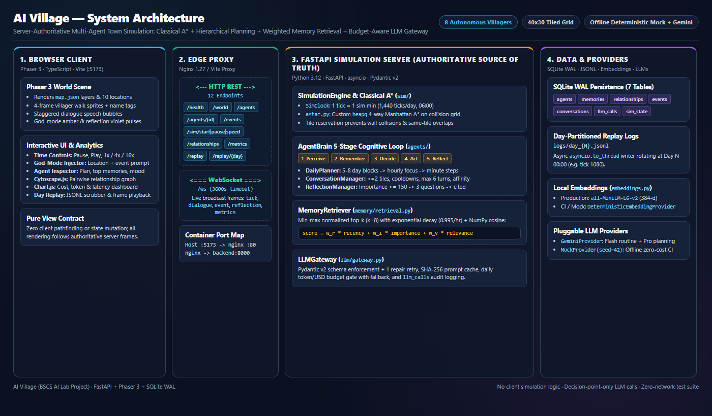

# AI Village: Autonomous Multi-Agent Town Simulation Combining Classical AI and Schema-Constrained LLM Reasoning

**Author:** AbdulRehman  
**Program:** 6th Semester BSCS — Artificial Intelligence Lab Project  
**Institution:** Superior University  
**Milestone:** v1.0 (Features F1–F14)  
**Artifact Reference:** [`docs/PRD.md`](PRD.md) (Sections 1, 5, 6, and 15) · Empirical Telemetry: [`.gsd/phases/6/day_simulation_metrics.json`](../.gsd/phases/6/day_simulation_metrics.json)

---

## Abstract

**AI Village** is a 2D browser-based multi-agent town simulation in which eight autonomous villagers—Maya (Baker), Liam (Barista), Elena (Botanist), Noah (Merchant), Clara (Archivist), Marcus (Chronicler), Aria (Florist), and Sam (Apothecary)—live out continuous simulated days at one-minute tick resolution. Inspired by Stanford's *Generative Agents* ("Smallville") architecture and engineered from scratch for a 6th-semester BSCS AI Lab deliverable, the system synthesizes **classical symbolic and algorithmic AI** (custom `heapq` A* heuristic search, three-tier hierarchical planning, structured relational knowledge representation, and utility-weighted episodic memory retrieval) with **schema-constrained Large Language Model (LLM) reasoning** routed through a centralized, cost-bounded gateway.

Crucially, **AI Village is not a Retrieval-Augmented Generation (RAG) chatbot.** Vector retrieval operates solely as an internal cognitive subroutine inside a closed `Perceive -> Remember -> Converse -> Decide -> Reflect -> Act` loop owned by an authoritative asynchronous Python server, while a decoupled Phaser 3, Cytoscape.js, and Chart.js frontend renders live WebSocket state and accepts viewer "god-mode" event injections.

In an end-to-end deterministic 1,440-tick simulation spanning **Day 1 06:00 through Day 2 06:00** (`seed=42`, offline `MockProvider` and `DeterministicEmbeddingProvider`), all eight agents executed full daily plans across midnight rollover with **0 wall collisions, 0 tile overlaps, 0 stationary overlaps, 0 invalid A\* steps, and 0 missing plan states**. Across the 24-hour simulated span, the agents accumulated **2,839 episodic memories** (`1,748` observations, `548` conversation memories, `398` plan memories, `145` cited reflections), held **274 multi-turn conversations** spanning **all 28 unique pairwise edges**, achieved **100% (8/8) village-wide awareness** for both injected god-mode emergencies/rumors, and logged **3,359 schema-validated LLM gateway calls** (`182` SHA-256 prompt-cache hits, `1,586,010` tokens, `0.646 ms` mock mean latency, `$0.00` offline cost, and `$0.31`–`$1.19` projected live Gemini cost).

---

## 1. Project Overview & Motivation (PRD Section 1)

Modern generative-agent benchmarks frequently obscure core artificial intelligence principles behind monolithic prompt chains or unconstrained API loops, resulting in high token expenditure, brittle spatial behavior, and non-reproducible evaluation. AI Village addresses both pedagogical clarity and production engineering rigor with four motivating design goals:

1. **Demonstrable Hybrid AI Architecture:** Clearly separate deterministic classical algorithms (A* graph search, discrete-time scheduling, persistent relational tables, normalized retrieval scoring) from stochastic semantic generation (planning, dialogue, importance rating, and reflective synthesis).
2. **Eight Distinct Villager Personas:** Populate a `40 × 30` tile town (`32 px` tiles, 10 named locations: `Bakery`, `Cafe`, `Market`, `Library`, `Park`, `Town Square`, `Home_Maya`, `Home_Liam`, `Home_Elena`, `Home_Noah`) with eight grounded villagers defined in `backend/agents/personas.py` (`SEEDED_PERSONAS`), each possessing unique traits, biographies, starting goals, and home anchors.
3. **Interactive Observability & God-Mode Perturbation:** Give instructors and reviewers real-time visibility into agent cognition—an Agent Inspector, Cytoscape.js relationship network, Chart.js cost/token/latency telemetry dashboard, time-dilation controls (`1x / 4x / 16x`), day-partitioned JSONL replay, and `POST /events` god-mode event injection to trigger emergent information diffusion.
4. **Reproducible, Cost-Controlled Execution:** Guarantee that every unit, integration, and 24-hour full-day test runs offline at `$0.00` via `MockProvider` while projecting and enforcing hard daily token/USD caps (`LLM_DAILY_TOKEN_LIMIT=250,000`, `LLM_DAILY_BUDGET_USD=0.50`) for live Google Gemini runs.

### Why AI Village Is Not a RAG Pipeline

In a standard RAG system, a user issues a prompt, top-$k$ chunks are retrieved from a static corpus, and a single answer is returned statelessly. In AI Village:
- **Continuous Feedback Loop:** Agent actions alter world positions (`x, y`), which generate new spatial observations, which update episodic memory and importance accumulators, which trigger reflections and replanning, which alter future A* destinations and future peers encountered.
- **Persistent Social State:** Conversations mutate canonical pairwise affinity scores (`relationships` table) and agent moods (`calm`, `warm`, `alert`, `concerned`), reshaping future dialogue framing and graph topology.
- **Decision-Point Invocation:** The LLM is never polled on every tick or on static queries; it is invoked strictly at state transitions (`daily_plan`, `replan`, `action_decomposition`, `importance_batch`, `conversation_decide`, `dialogue_turn`, `conversation_summary`, `salient_questions`, `reflection`).

---

## 2. System Architecture (PRD Section 6)

AI Village implements a strict **server-authoritative client-server architecture**. The FastAPI backend owns the simulation clock, spatial collision map, agent brains, SQLite database, LLM gateway, and JSONL replay writer; the browser client never computes pathfinding, memory scores, or simulation transitions.

### Architectural Layers

| Layer | Technologies & Modules | Primary Responsibilities |
| :--- | :--- | :--- |
| **Browser Client** | Phaser 3, TypeScript 5.6, Vite 5.4, Cytoscape.js 3.35, Chart.js 4.6 (`frontend/src/`) | Tilemap & sprite interpolation (`VillageScene.ts`), passive WebSocket client (`wsClient.ts`), typed REST client (`apiClient.ts`), Agent Inspector, Time Controls, Event Injector, Activity Feed, Relationship Graph Modal, Cost Dashboard, Day Replay Scrubber |
| **Edge Proxy (Docker)** | Nginx 1.27 (`frontend/nginx.conf`, `frontend/Dockerfile`) | Serves static compiled Vite bundle on port `80` (mapped to host `5173`), upgrades `/ws` connections, and proxies all 8 REST prefixes (`/health`, `/world`, `/agents`, `/events`, `/sim`, `/relationships`, `/metrics`, `/replay`) to `backend:8000` |
| **FastAPI Server** | Python 3.12, FastAPI, Uvicorn, Pydantic v2 (`backend/app/main.py`, `backend/api/`) | Manages lifespan dependencies, exposes 12 REST endpoints (`rest.py`) and live `/ws` broadcaster (`ws.py`), enforces CORS and request validation |
| **Simulation Engine** | `backend/sim/` (`clock.py`, `world.py`, `astar.py`, `engine.py`, `replay.py`) | Advances discrete `SimClock`, parses `map.json`, executes `heapq` A*, runs concurrent `asyncio` agent cognition + sequential collision-free movement under `_step_lock`, emits `tick`/`dialogue`/`event`/`reflection`/`metrics` frames, appends day-partitioned JSONL logs |
| **Agent Brain** | `backend/agents/` (`personas.py`, `agent.py`, `planner.py`, `conversation.py`, `reflection.py`) | Executes `Perceive -> Remember -> Converse -> Decide -> Reflect`, 3-tier planning, proximity-gated dialogue, and threshold-triggered cited reflections |
| **Memory Service** | `backend/memory/` (`models.py`, `store.py`, `embeddings.py`, `retrieval.py`) | Manages async SQLite CRUD, 384-d `float32` BLOB packing (`1,536` bytes/vector), `all-MiniLM-L6-v2` or deterministic BLAKE2b embeddings, and vectorized NumPy retrieval |
| **LLM Gateway** | `backend/llm/` (`gateway.py`, `schemas.py`, `prompts/`, `providers/`) | Single gateway enforcing strict Pydantic v2 JSON schemas (`ConfigDict(extra="forbid")`), 1-retry validation repair, SHA-256 prompt cache, daily budget gate, model tiering, and `llm_calls` telemetry logging |

### Persistence Schema & Replay Storage

SQLite runs asynchronously via `SQLModel` + `aiosqlite` (`backend/app/db.py`) with `PRAGMA foreign_keys=ON`, `PRAGMA journal_mode=WAL`, `PRAGMA synchronous=NORMAL`, and `PRAGMA busy_timeout=5000` across seven normalized tables (`backend/memory/models.py`):

1. `agents`: `id`, `name`, `persona_json`, `home_location`, `x`, `y`, `current_action`, `current_plan_json`, `mood`
2. `memories`: `id`, `agent_id` (FK), `type` (`observation | plan | conversation | reflection`), `text`, `importance` (`1..10`), `created_tick`, `last_access_tick`, `embedding` (`LargeBinary`), `metadata_json`
3. `relationships`: composite PK `(agent_a, agent_b)` with canonical lexicographic ordering (`agent_a < agent_b`), `affinity` (`[-1.0, 1.0]`), `notes`, `last_interaction_tick`
4. `events`: `id`, `tick`, `kind`, `text`, `location`, `source`
5. `conversations`: `id`, `tick_start`, `participants`, `transcript_json`, `summary`
6. `llm_calls`: `id`, `tick`, `agent_id`, `purpose`, `model`, `tokens_in`, `tokens_out`, `latency_ms`, `cost_est`, `cache_hit`
7. `sim_state`: singleton checkpoint (`id=1`, `tick`, `sim_time`, `speed`, `seed`)

Alongside SQLite, `ReplayLogger` (`backend/sim/replay.py`) appends structured JSONL frames (`tick`, `dialogue`, `event`, `reflection`) partitioned by simulated calendar day (`day_1.jsonl`, `day_2.jsonl`, …) using `replay_day_for_tick(tick, start_minute_of_day=360)`.

---

## 3. Simulation Design & Cognitive Algorithms (PRD Section 5)

### 3.1 Discrete Time & Decision-Point Cadence (PRD §5.1)

`SimClock` (`backend/sim/clock.py`) models discrete simulation time where **1 tick = 1 simulated minute**, starting at `start_minute_of_day = 360` (**Day 1 06:00**) with `TICKS_PER_DAY = 1440`. Derived clock attributes map any integer `tick >= 0` deterministically:

$$\text{total\_minutes}(t) = 360 + t, \qquad \text{day}(t) = \left\lfloor \frac{360 + t}{1440} \right\rfloor + 1, \qquad \text{hour}(t) = \left\lfloor \frac{(360 + t) \bmod 1440}{60} \right\rfloor$$

Playback speed supports `VALID_SPEEDS = (1, 4, 16)` with interval `base_tick_seconds / speed` (`1.0 s`, `0.25 s`, and `0.0625 s` at default `SIM_TICK_SECONDS=1.0`). At `tick = 1080` (`360 + 1080 = 1440`), the simulated calendar rolls over from `Day 1 23:59` to `Day 2 00:00`. Crucially, the async loop never calls the LLM on idle movement or dwell ticks unless a cognitive decision point occurs.

### 3.2 Five-Stage Agent Loop (PRD §5.2)

Each tick inside `SimulationEngine.step_once()` (`backend/sim/engine.py`) acquires `_step_lock` and executes a deterministic five-stage cognitive phase across all eight agents concurrently via `asyncio`, followed by sequential movement and clock advancement:

1. **Perceive (`_perceive_and_remember`):** Each agent drains queued world/arrival observations (`PendingObservation`) and detects nearby peers within Manhattan radius $\le 4$ tiles, deduplicated by `peer_perception_cooldown = 25` ticks.
2. **Remember (`rate_importance_batch` + `add_memories_batch`):** All newly perceived observations across all agents in the tick are batched into a single `importance_batch` LLM call returning integer scores $1\dots 10$, then embedded and persisted to `memories`. Any observation with `trigger_replan=True` or importance $\ge 7$ (respecting `replan_cooldown = 10`) flags `needs_replan = True`.
3. **Converse & Decide (`_run_conversations`, `_decide_actions`):** Disjoint free agent pairs within proximity engage in turn-based dialogue; non-conversing agents generate wake-up plans, execute interruption replans, or lazily resolve the current `MinuteStep` via `MemoryRetriever` + `DailyPlanner`.
4. **Act (`_step_agent`):** Non-conversing agents resolve A* paths (`find_path`) to their target location's anchor (or an adjacent unoccupied tile) and advance one cardinal tile per tick while maintaining a `reserved_tiles` occupancy set.
5. **Reflect (`_run_reflections`):** Any agent whose `accumulated_importance >= reflection_threshold` (`150`) synthesizes cited higher-level insights and updates its mood.

### 3.3 Memory Stream & Weighted Retrieval Mathematics (PRD §5.3)

`MemoryRetriever.retrieve()` (`backend/memory/retrieval.py`) ranks all stored memories $M_a$ of agent $a$ against a query string $q$ at current tick $t$ by computing three raw signals and min-max normalizing each across the candidate pool:

1. **Exponential Recency Decay:** Given elapsed hours $\Delta h(m, t) = \max\!\left(0,\; \frac{t - t_{\text{access}}(m)}{60.0}\right)$ and hourly decay factor $\gamma = 0.995$:
   $$r_{\text{raw}}(m, t) = 0.995^{\Delta h(m, t)}$$
2. **Normalized Importance:** Integer importance $I(m) \in \{1,\dots,10\}$ scaled by $10.0$:
   $$i_{\text{raw}}(m) = \frac{I(m)}{10.0}$$
3. **Vectorized Cosine Relevance:** Using packed 384-d `float32` embeddings (`EMBEDDING_DIM = 384`) produced either by `SentenceTransformerEmbeddingProvider("all-MiniLM-L6-v2")` in `local` mode or signed BLAKE2b token + bigram hashing (`DeterministicEmbeddingProvider`) in `mock` mode:
   $$v_{\text{raw}}(m, q) = \frac{\mathbf{e}(m) \cdot \mathbf{e}(q)}{\max\!\left(\|\mathbf{e}(m)\|_2 \,\|\mathbf{e}(q)\|_2,\; 10^{-12}\right)}$$
4. **Min-Max Component Normalization:** For any candidate vector $\mathbf{x} \in \mathbb{R}^{|M_a|}$:
   $$\tilde{x}_j = \begin{cases} \operatorname{clip}(x_j, 0, 1), & \text{if } \max(\mathbf{x}) - \min(\mathbf{x}) < 10^{-9} \\ \dfrac{x_j - \min(\mathbf{x})}{\max(\mathbf{x}) - \min(\mathbf{x})}, & \text{otherwise} \end{cases}$$
5. **Weighted Linear Combination & Touch Update:**
   $$\operatorname{score}(m, q, t) = w_r \,\tilde{r}(m, t) + w_i \,\tilde{i}(m) + w_v \,\tilde{v}(m, q)$$
   with default weights $w_r = w_i = w_v = 1.0$. Ties break deterministically by `(score, created_tick, id)` descending, the top-$k$ ($k = 8$) memories are returned, and `last_access_tick` is updated to $t$ (`touch_memories`).

### 3.4 Hierarchical Planning & Replanning (PRD §5.4)

`DailyPlanner` (`backend/agents/planner.py`) prevents per-tick LLM chatter while maintaining flexible schedules across three levels of temporal abstraction:

- **Level 1 — Broad Daily Plan (`DailyPlanResponse`):** Generated at wake-up (or Day 1 $\to$ Day 2 rollover when `plan_state.day != clock.day`), retrieving top-8 goal-relevant memories and producing **5–8 time blocks** (`start_hour`, `end_hour`, `location`, `description`), stored as a `plan` memory (`importance = 6`).
- **Level 2 — Lazy Hourly Decomposition (`HourlyActionPlanResponse`):** Blocks are decomposed into `hourly_focus` and `1..6` concrete `MinuteStep` items (`duration_minutes`, `location`, `action`) **lazily upon first block entry**, cached in `minute_steps_by_block`, and capped in dwell ticks (`max(dwell_ticks, 8)`).
- **Level 3 — Interruption Replanning (`ReplanResponse`):** When a god-mode event (`importance = 8`) or salient observation/conversation (`importance >= 7`) sets `needs_replan = True`, `replan_remaining_day()` preserves completed blocks (`end_hour <= clock.hour`) along with their existing steps/focus, retrieves memories matching the interruption reason, and generates `1..8` updated blocks for the remainder of the day (`importance = 7`).

Every LLM-returned destination string passes through `canonicalize_location(raw_location, world, fallback_location)` using a 5-stage deterministic matcher (exact key $\to$ alphanumeric-collapsed key $\to$ longest forward substring $\to$ unique reverse substring $\to$ persona home fallback), guaranteeing `world.get_location(...)` never raises `KeyError`.

### 3.5 Multi-Agent Conversations & Rumor Spread (PRD §5.5)

`ConversationManager` (`backend/agents/conversation.py`) governs emergent social encounters and multi-hop information propagation:

- **Eligibility & Matching:** `select_candidate_pairs()` greedily pairs disjoint free agents (`conversation_hold_ticks == 0`) within **`PROXIMITY_TILES = 2`** Manhattan distance whose canonical pair cooldown has expired (`CONVERSATION_COOLDOWN_TICKS = 60` after dialogue, `DECLINE_COOLDOWN_TICKS = 30` if declined). Engine ordering prioritizes agents with pending `needs_replan` or more recent `last_salient_tick` as initiator.
- **Memory-Grounded Initiation & Turns:** Both agents retrieve top-8 peer/location-relevant memories. `decide_conversation()` gates initiation; if accepted, agents alternate for up to **`MAX_DIALOGUE_TURNS = 6`** turns (`generate_dialogue_turn()`, early exit permitted once `len(turns) >= 2` and `continue_dialogue=False`).
- **Summarization, Social Graph & Propagation:** `summarize_conversation()` distills the transcript into a concise summary, rates its importance (`importance_batch`), persists two `conversation` memories (one per speaker) and one `conversations` row, updates canonical relationship `affinity` (clamped to `[-1.0, 1.0]`) and `notes`, sets `conversation_hold_ticks` between `2` and `4` ticks, and triggers `needs_replan = True` for both participants when `importance >= 7`—allowing urgent news or rumors to propagate across subsequent encounters.

### 3.6 Threshold Reflection & Mood Evolution (PRD §5.6)

`ReflectionManager` (`backend/agents/reflection.py`) models higher-order episodic synthesis whenever `accumulated_importance >= 150` (`REFLECTION_THRESHOLD=150`):

1. **Salient Question Formulation:** Retrieves the agent's 20 most recent memories and prompts `generate_salient_questions()` (`planning_model`) for **exactly 3 salient questions** (`SalientQuestionsResponse`).
2. **Multi-Query Evidence Aggregation:** Runs `MemoryRetriever.retrieve(..., top_k=8)` for each of the 3 questions, deduplicating and ranking up to `max(12, 2 * 8) = 16` highest-scoring evidence `(memory_id, text)` pairs.
3. **Cited Insight Synthesis:** Prompts `generate_reflections()` to emit `1..5` insights (capped to top 3 persisted) with explicit `cited_memory_ids` validated against the evidence set, persisting each as a `reflection` memory (`importance = 8`, citations stored in `metadata_json`), updating the agent's `mood`, resetting `accumulated_importance = 0`, and broadcasting `reflection` frames to `/ws` and the JSONL replay log.

### 3.7 God-Mode Event Injection (PRD §5.7)

Viewers inject events via `POST /events` (`text`, optional case-insensitive `location`). `SimulationEngine.inject_event()` (`backend/sim/engine.py`) does not block on `_step_lock`: it identifies all agents if `location` is omitted, or all agents within Manhattan radius $\le 10$ of the location anchor, inside its Tiled bounding rectangle, or currently targeting that location. Each affected agent receives an `[EVENT]` observation (`importance = 8`), sets `needs_replan = True`, logs a `god_event` row to `events`, broadcasts an `event` frame over `/ws`, and writes an `event` frame to the day's replay log.

### 3.8 Classical A* Grid Search (PRD §5.8)

`find_path()` (`backend/sim/astar.py`) implements hand-written `heapq` A* search over the `40 × 30` Tiled collision grid (`WorldMap`) using 4-way cardinal steps `CARDINAL_DIRS = ((0, -1), (1, 0), (0, 1), (-1, 0))` and unit step cost $g(n') = g(n) + 1$:

$$f(n) = g(n) + h(n), \qquad h(n) = |x_n - x_g| + |y_n - y_g|$$

Because Manhattan distance $h(n)$ never overestimates the true 4-way grid distance and satisfies triangle consistency ($h(n) \le 1 + h(n')$), A* is both **admissible** and **consistent**, guaranteeing shortest collision-free paths. Heap entries use `(f_score, h_score, tie_seq, pos)` so equal-$f$ nodes prefer lower heuristic distance and FIFO insertion stability, bounded by `max_iterations = 20_000`.

To prevent multi-agent deadlocks or tile overlaps in narrow doorways:
- `SimulationEngine._compute_path_to_target()` treats other agents' positions as `blocked_tiles` when planning; if the exact anchor is occupied, `WorldMap.find_free_adjacent()` locates the nearest unoccupied walkable tile (`max_radius = 4`).
- Each agent reserves its occupied tile in `reserved_tiles` during `_step_agent()`, clearing and popping `reserved_tiles` cleanly on every single step.
- If the next tile along `agent.path` becomes temporarily occupied, the agent waits and increments `stall_ticks`; after `MAX_STALL_TICKS = 15`, it force-recomputes an alternate A* detour around `reserved_tiles`.

---

## 4. Schema-Enforced LLM Gateway & Cost Control (PRD Section 10)

Every LLM request across the entire codebase passes exclusively through `LLMGateway` (`backend/llm/gateway.py`):

1. **Strict Pydantic v2 Schema Validation & 1-Retry Repair:** Every purpose binds to one of 9 Pydantic v2 schemas (`backend/llm/schemas.py`) configured with `ConfigDict(extra="forbid")` (`ImportanceBatchResponse`, `DailyPlanResponse`, `ReplanResponse`, `HourlyActionPlanResponse`, `ConversationDecisionResponse`, `DialogueTurnResponse`, `ConversationSummaryResponse`, `SalientQuestionsResponse`, `ReflectionResponse`). If `model_validate_json()` raises `ValidationError`, `_build_repair_prompt()` appends the validation error and JSON schema for `max_retries = 1` repair attempt before raising `LLMGatewayError`.
2. **SHA-256 Prompt Deduplication Cache:** `_build_cache_key()` hashes `[model_hint, purpose, schema_name, system_instruction, prompt]` with SHA-256. Cache hits validate cached JSON, record `tokens_in=0, tokens_out=0, cost_est=0.0, cache_hit=True` to `llm_calls`, and avoid duplicate provider calls.
3. **Model Tiering:** `_resolve_requested_model()` routes heavy structural/cognitive tasks (`daily_plan`, `replan`, `hourly_plan`, `reflection`, `salient_questions`) to `gemini_planning_model` (`gemini-2.5-pro`, `$1.25 / $10.00` per 1M input/output tokens) and routine tasks (`importance_batch`, `dialogue_turn`, `action_decomposition`, `conversation_decide`, `conversation_summary`) to `gemini_routine_model` (`gemini-2.5-flash`, `$0.15 / $0.60` per 1M tokens).
4. **Hard Daily Budget Gate & Graceful Mock Fallback:** Before calling the primary provider, `LLMGateway` checks whether `_daily_tokens[day] >= daily_token_limit` (`250,000`) or `_daily_cost[day] >= daily_budget_usd` (`$0.50`). Once exhausted, it transparently switches to `fallback_provider` (`MockProvider`) for the remainder of that 1,440-tick budget day so the simulation never crashes mid-day.
5. **Batched Importance Scoring & `llm_calls` Audit Log:** All observations arriving across all 8 agents in a single tick are scored in one `rate_importance_batch()` call, and every invocation (hit or miss) persists to `llm_calls`.

---

## 5. Mapping to AI Course Concepts (PRD Section 15)

| AI Course Topic | Conceptual Role in AI Village | Concrete Module, Equation & Empirical Mechanism |
| :--- | :--- | :--- |
| **Intelligent Agents** | Goal-directed rational agent architecture in a partially observable, dynamic multi-agent environment | `AgentBrain` & `SimulationEngine`: `Perceive -> Remember -> Converse -> Decide -> Reflect -> Act` loop (`backend/agents/agent.py`, `backend/sim/engine.py`) |
| **Informed Heuristic Search** | Optimal grid navigation with admissible & consistent heuristic | Custom `heapq` A* with $f(n)=g(n)+|x_n-x_g|+|y_n-y_g|$ on 40×30 grid, occupancy avoidance, and 15-tick stall rerouting (`backend/sim/astar.py`) |
| **Hierarchical Planning (HTN-style)** | Multi-horizon temporal decomposition & reactive replanning under interruptions | `DailyPlanner`: 5–8 broad day blocks $\to$ lazy hourly focus + `MinuteStep`s + prefix-preserving `replan_remaining_day()` (`backend/agents/planner.py`) |
| **Knowledge Representation** | Hybrid symbolic + vector episodic memory, relational graph, and structured persona ontology | 7-table SQLite schema (`memories` with 384-d vectors & `metadata_json` citations, canonical `relationships`, `agents`, `events`, `conversations`, `llm_calls`, `sim_state`) (`backend/memory/models.py`) |
| **Utility / Retrieval Scoring & Reasoning Under Uncertainty** | Combining temporal decay, salience, and semantic similarity; threshold-triggered synthesis; stochastic dialogue gating | $\text{score} = w_r\tilde{r}(0.995^{\Delta h}) + w_i\tilde{i} + w_v\tilde{v}$ (`backend/memory/retrieval.py`), `importance_batch` rating, `conversation_decide` gating, `accumulated_importance >= 150` reflection |
| **Multi-Agent Systems** | Decentralized proximity interaction, social affinity evolution, and emergent rumor diffusion | `ConversationManager`: Manhattan $\le 2$ pairing, 60/30-tick cooldowns, $\le 6$-turn dialogues, canonical undirected affinity graph $[-1, 1]$, multi-hop event propagation (`backend/agents/conversation.py`) |
| **Modern LLM Integration** | Constrained structured decoding, cost optimization, and deterministic testing | `LLMGateway`: Pydantic v2 `extra="forbid"` schemas, 1-retry repair, SHA-256 cache, Flash/Pro tiering, daily budget cap + `MockProvider` (`backend/llm/gateway.py`) |

---

## 6. Empirical Evaluation: Full 1,440-Tick Simulated Village Day

To validate Milestone v1.0 end-to-end without network dependencies, `scripts/run_day_simulation.py` executed a full **1,440-tick (24-hour)** simulation (`seed=42`, `LLM_PROVIDER=mock`, `EMBEDDING_PROVIDER=mock`, `sim_tick_seconds=0.05`) inside an isolated SQLite WAL database and temporary JSONL replay directory, injecting two mid-day god-mode events via `POST /events`. All values below come directly from [`.gsd/phases/6/day_simulation_metrics.json`](../.gsd/phases/6/day_simulation_metrics.json) (`ticks_completed=1440`, `total_calls=3359`).

### 6.1 Run Summary & Spatial/Cognitive Invariants

| Metric | Observed Value | Verification Criterion |
| :--- | :--- | :--- |
| Simulated Horizon | `Day 1 06:00` $\to$ `Day 2 06:00` (`1,440` ticks) | Crosses midnight Day 1 $\to$ Day 2 rollover at tick `1,080` |
| Wall-Clock Runtime | `383.596 s` (`266.39 ms/tick` mean) | Includes full SQLite persistence, embeddings, and JSONL logging |
| Wall Collisions | `0` | Every agent tile satisfies `world.is_walkable(x, y)` on all 1,440 ticks |
| Tile Overlaps | `0` | All 8 agents occupy distinct `(x, y)` tiles after every tick |
| Stationary Overlaps | `0` | Dwelling, conversing, and arrived agents never share a tile |
| Invalid A* Path Steps | `0` | Every queued step is walkable and Manhattan distance `1` from previous tile |
| Missing Plan States | `0` | Day 1 (`8/8` agents) and Day 2 (`8/8` agents) plans generated cleanly |
| Plan Memories & Calls | `398` plan memories (`16` `daily_plan`, `382` `replan`, `481` `action_decomposition`) | 8 wake-up plans on Day 1 + 8 rollover plans on Day 2 (`16` total) |

### 6.2 Memory Stream, Reflections & Social Relationship Network

Across the 24-hour run, the village generated **2,839 persisted memories** (`avg = 354.9` per agent; range `211` for Marcus to `420` for Liam):

| Memory / Cognitive Metric | Observed Count / Value | Notes |
| :--- | :--- | :--- |
| Total Persisted Memories | `2,839` | Breakdown: `1,748` observation (`61.6%`), `548` conversation (`19.3%`), `398` plan (`14.0%`), `145` reflection (`5.1%`) |
| Per-Agent Memory Totals | Liam `420`, Clara `411`, Maya `394`, Elena `369`, Noah `368`, Aria `361`, Sam `305`, Marcus `211` | Balanced multi-agent episodic accumulation |
| Total Conversations | `274` (`2`–`6` turns, avg `3.89` turns/dialogue) | Reached **`28 / 28`** unique agent pairs ($100\%$ graph density) |
| Threshold Reflections | `145` total across `8 / 8` agents | **`145 / 145` (`100%`)** cited valid evidence (`min = 5`, `max = 5` citations/insight; `290` unique cited memory IDs) |
| Relationship Network (`GET /relationships`) | `8` nodes, `28` canonical edges | Affinity range `[-0.3, 1.0]`, mean `0.6607`; `26` positive edges, `2` negative edges (`Marcus–Sam = -0.3`, `Maya–Noah = -0.15`), `0` neutral edges |

### 6.3 God-Mode Event Injection & Emergent Rumor Propagation

Two mid-day events were injected via `POST /events` to evaluate interruption replanning and multi-hop social information spread:

| Event | Injection Tick & Sim Time | Initial Witnesses (`replan_cleared_at`) | Final Aware Agents | Secondary Spread (`spread_delta`) & Propagation Timeline |
| :--- | :--- | :--- | :--- | :--- |
| **Market Fire:** *"Sudden fire near the Market spice stalls"* (`Market`) | Tick `380` (`Day 1 12:20`) | `3 / 8` (`aria`, `elena`, `maya`; all 3 replanned at tick `381`) | **`8 / 8` (`100%`)** | `+5` secondary agents: Noah (`424`), Liam (`436`), Sam (`442`), Clara (`553`), Marcus (`806`) |
| **Bakery Saffron Rumor:** *"Rumor spreads that Maya hid rare saffron loaves at the Bakery"* (`Bakery`) | Tick `440` (`Day 1 13:20`) | `2 / 8` (`clara`, `marcus`; both replanned at tick `441`) | **`8 / 8` (`100%`)** | `+6` secondary agents: Elena (`812`), Maya (`896`), Aria (`1041`), Sam (`1092`), Noah (`1094`), Liam (`1105`) |

Both perturbations were processed within **1 tick** for initial witnesses' schedules (`380 -> 381`, `440 -> 441`) and diffused organically across conversational hops until every villager held memory of both events.

### 6.4 LLM Gateway Telemetry, Cache Efficiency & Projected Live Gemini Cost

Every call recorded by `/metrics` matched SQLite `llm_calls` identically (`db_parity_ok: true`): **3,359 total calls**, **182 cache hits** (`5.42%` overall hit rate; `20.78%` hit rate on `importance_batch` where `182 / 876` repeated observations were deduplicated), **1,423,807 input tokens**, **162,203 output tokens** (**1,586,010 total tokens**), `0.646 ms` mean mock latency (`13.1 ms` max), and **`$0.00` actual offline cost**.

To provide transparent cost planning for live deployments, `scripts/run_day_simulation.py` projects the exact observed token counts against `MODEL_PRICING_PER_MILLION` (`gemini-2.5-flash`: `$0.15 / $0.60` per 1M in/out tokens; `gemini-2.5-pro`: `$1.25 / $10.00` per 1M in/out tokens):

| Purpose | Calls | Cache Hits | Tokens In | Tokens Out | Total Tokens | Avg Latency (ms) | Projected Tiered Model | Projected Cost (USD) |
| :--- | ---: | ---: | ---: | ---: | ---: | ---: | :--- | ---: |
| `importance_batch` | `876` | `182` | `62,331` | `2,788` | `65,119` | `0.307` | `gemini-2.5-flash` | `$0.011022` |
| `dialogue_turn` | `792` | `0` | `464,286` | `28,426` | `492,712` | `0.727` | `gemini-2.5-flash` | `$0.086698` |
| `action_decomposition` | `481` | `0` | `265,682` | `48,739` | `314,421` | `0.846` | `gemini-2.5-flash` | `$0.069096` |
| `replan` | `382` | `0` | `226,585` | `32,237` | `258,822` | `0.873` | `gemini-2.5-pro` | `$0.605601` |
| `conversation_decide` | `348` | `0` | `182,080` | `14,220` | `196,300` | `0.592` | `gemini-2.5-flash` | `$0.035844` |
| `conversation_summary` | `274` | `0` | `66,537` | `18,929` | `85,466` | `0.492` | `gemini-2.5-flash` | `$0.021338` |
| `reflection` | `95` | `0` | `72,928` | `6,981` | `79,909` | `1.500` | `gemini-2.5-pro` | `$0.160970` |
| `salient_questions` | `95` | `0` | `76,768` | `6,543` | `83,311` | `1.037` | `gemini-2.5-pro` | `$0.161390` |
| `daily_plan` | `16` | `0` | `6,610` | `3,340` | `9,950` | `0.263` | `gemini-2.5-pro` | `$0.041662` |
| **Total** | **`3,359`** | **`182`** | **`1,423,807`** | **`162,203`** | **`1,586,010`** | **`0.646`** | **Tiered Flash + Pro** | **`$1.193622`** |

**Budget & Cost Interpretation:**
- An uncapped 24-hour run using `gemini-2.5-pro` for planning (`382,891` input / `49,101` output tokens) and `gemini-2.5-flash` for routine calls (`1,040,916` input / `113,102` output tokens) projects to **`$1.193622`**, with `replan` (`$0.605601`) accounting for `50.7%` of total cost.
- Routing all 3,359 calls to `gemini-2.5-flash` cuts the full 24-hour projected cost by **73.95% to `$0.310893`**, comfortably under the default `LLM_DAILY_BUDGET_USD=0.50` cap.
- Under default production guardrails (`LLM_DAILY_TOKEN_LIMIT=250,000`, `LLM_DAILY_BUDGET_USD=0.50`), `LLMGateway` tracks per-budget-day usage (`budget_day = (tick // 1440) + 1`, resetting cleanly to `0` at tick `1,440`) and gracefully falls back to `MockProvider` once either daily cap is reached.

### 6.5 Replay Log Partitioning & End-of-Day Villager State

`ReplayLogger` wrote two clean JSONL logs verified via `GET /replay` and `GET /replay/{day}`:
- **`day_1.jsonl`:** `1,080` tick frames (`0..1079`, `Day 1 06:00` $\to$ `Day 1 23:59`) plus `228` dialogue, `117` reflection, and `2` event frames (`1,427` total frames).
- **`day_2.jsonl`:** `361` tick frames (`1080..1440`, `Day 2 00:00` $\to$ `Day 2 06:00`) plus `46` dialogue and `28` reflection frames (`435` total frames).

At `tick = 1440` (`Day 2 06:00`), all 8 villagers had active Day 2 plans (`plan_day = 2`) and exhibited distinct moods (`concerned` for Aria, Clara, Elena, Noah; `alert` for Liam, Marcus, Maya, Sam) shaped by the preceding day's fire and rumor interactions.

---

## 7. Verification Strategy, Limitations & Future Work

### Verification Strategy

Every subsystem is covered by automated offline verification in CI (`.github/workflows/ci.yml`):
- **Static Quality Gates:** `ruff check` and `mypy --strict` across both `backend/` and `scripts/`, plus TypeScript `tsc --noEmit` and Vite production bundling (`npm run build`) in `frontend/`.
- **Unit & Integration Tests (`pytest`):** Covers A* optimality and obstacle avoidance, `SimClock`, `WorldMap`, memory packing/retrieval math, `LLMGateway` caching/repair/budget enforcement, hierarchical planning, proximity conversations, threshold reflections, REST/WS contracts, Docker/Nginx route parity, 100-tick invariants, and the full 1,440-tick Day 1 $\to$ Day 2 integration test (`backend/tests/test_full_day_simulation.py`).
- **Live End-to-End Smoke Test:** `scripts/verify_phase1_ws.py` validates built `frontend/dist` assets, boots Uvicorn, exercises `/health`, `/world`, `/agents`, and verifies live `/ws` tick delivery.

### Known Limitations

1. **Deterministic Mock Semantics vs. Live LLM Diversity:** In offline mode, `MockProvider` generates rule-based, template-grounded JSON responses and `DeterministicEmbeddingProvider` uses signed BLAKE2b token/bigram hashing rather than contextual neural embeddings (`all-MiniLM-L6-v2`). While this proves all cognitive state transitions, invariants, and rumor propagation paths deterministically, live `GeminiProvider` + `local` SentenceTransformer runs yield richer conversational phrasing and semantic recall.
2. **2D Grid Abstraction:** Agents navigate discrete `40 × 30` tiles at 1 tile/tick in cardinal directions without continuous physics or multi-room interior furniture interaction beyond named location zones.

### Future Work (PRD P2 Stretch Roadmap)

- **F15 — Persona-Consistency Evaluation:** Automated LLM-as-judge scoring across sampled dialogue lines paired with quantitative rumor-diffusion benchmarks.
- **F16 — Local Model Fallback (`Ollama`):** Adding an `OllamaProvider` behind `LLMGateway` between Gemini rate-limit fallback and `MockProvider`.
- **F17 — Day/Night Cycle & Weather:** Visual shader/tint cycles in `VillageScene.ts` coupled with weather observations capable of triggering indoor replanning.
